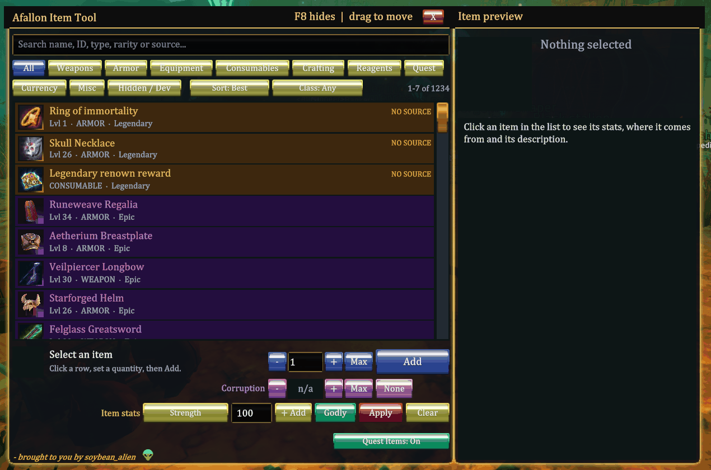
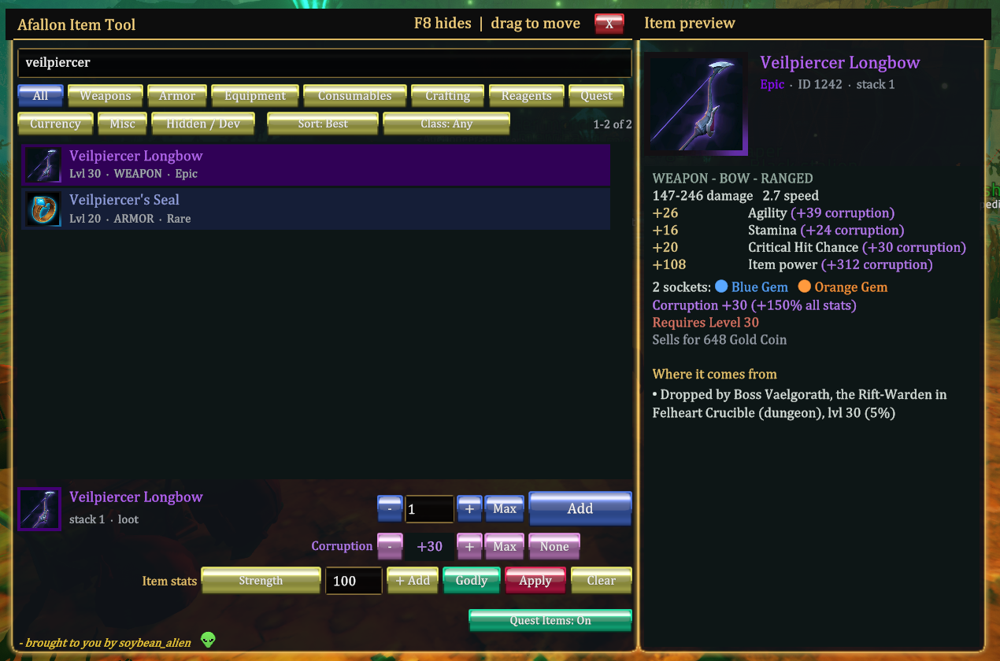
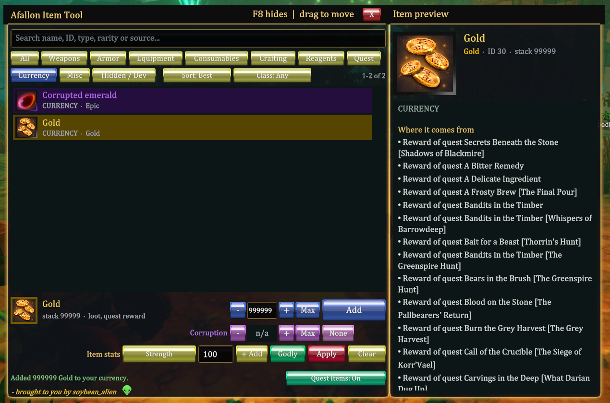

# Afallon Item Spawner: an in-game item spawner for Afallon

**v0.3.0-alpha.** A BepInEx 6 IL2CPP plugin for testing. Build out a character and try
gear, builds and items *before* you commit to them on a real playthrough. Press **F8**
in-game to open a window listing every item in the game, then click **Add** to put one
in your bag.



- **Every item:** all 1,234, including quest items and hidden/developer items, with the game's own icons.
- **Find anything:** search by name, ID, type, rarity, class or source; category tabs; class filter.
- **Sort:** best-for-class (uses the game's own loot logic), level, item power, name, or any stat.
- **Preview:** stats, socket colours, level requirement, plain-language on-use effects, and where the item comes from (boss and dungeon, mobs, open-world drops, vendor, recipe, quest).
- **Spawn:** any quantity. Currency (Gold, Corrupted emeralds) goes straight into your wallet; the game caps Gold at 900,000.
- **Corruption:** gear at +1…+30, and Corruption Tokens at any level.
- **Item stats:** custom or "Godly" stat overrides, applied in memory and never written into saves.
- **Bag size:** optionally bigger, with a guard against accidental item loss.

> **⚠ Alpha. For testing purposes only. Use with caution: saves are not guaranteed.**
> Back up your save folder first, and preferably test on a throwaway character.

Unofficial fan mod. Afallon is developed and published by **Stargazing Interactive**;
this project is **not affiliated with, endorsed by, or sponsored by Stargazing
Interactive** or Valve. See [DISCLAIMER.md](DISCLAIMER.md).

| Item preview | Currency spawn |
|---|---|
|  |  |

## For players: install

Windows only. The mod runs inside the game through the BepInEx mod loader, which is
**REQUIRED**.

### What you need

- **REQUIRED:** **Afallon 0.16.3** (Steam, Windows 64-bit).
- **REQUIRED:** **BepInEx 6 Bleeding Edge, IL2CPP, build #788**. Direct download:
  **[BepInEx-Unity.IL2CPP-win-x64-6.0.0-be.788+5b766a3.zip](https://builds.bepinex.dev/projects/bepinex_be/788/BepInEx-Unity.IL2CPP-win-x64-6.0.0-be.788%2B5b766a3.zip)**
  (about 34 MB; [all builds](https://builds.bepinex.dev/projects/bepinex_be)).
  **BepInEx 5 and the Mono builds will not work.** Other BepInEx 6 builds are untested.
- **`AfallonItemSpawner-0.3.0-alpha.zip`** from [Releases](../../releases).

### Steps

1. **Back up your saves.** Close Afallon, press **Win + R**, paste
   `%USERPROFILE%\AppData\LocalLow\Stargazing interactive\Afallon` and press Enter,
   then copy that folder somewhere safe.
2. **Open the game folder.** In Steam, right-click **Afallon**, choose **Manage**, then
   **Browse local files**.
3. **Install BepInEx.** Extract the BepInEx zip into the game folder, so that
   `BepInEx\`, `dotnet\` and `winhttp.dll` sit next to `Afallon.exe`.
4. **Start Afallon once** and wait for the main menu. The first start takes 1–5 minutes
   while BepInEx prepares itself, and it may look frozen. Then quit.
5. **Install the mod.** Unzip `AfallonItemSpawner-0.3.0-alpha.zip` into the game folder
   (merge the `BepInEx` folder). You should now have
   `BepInEx\plugins\AfallonItemSpawner\AfallonItemSpawner.dll`.
6. **Play.** Start Afallon and load a character. Press **F8**, pick an item, set the
   quantity, then press **Add**.

The full guide, including usage, every setting, and the bag-size warning, is
[INSTALL.md](dist-template/INSTALL.md). It also ships in the zip.

### Uninstall

If you enlarged the bag, first move everything into the first 105 slots. Then close the
game and delete `BepInEx\plugins\AfallonItemSpawner\` (and optionally
`BepInEx\config\soybean_alien.afallon.itemspawner*`). Spawned items stay in your
inventory; stat overrides disappear with the mod.

### Troubleshooting

- **No window and no `BepInEx\LogOutput.log`:** BepInEx isn't installed correctly. Use build #788 IL2CPP, with its files next to `Afallon.exe`.
- **The game froze:** you selected text in the black BepInEx console. Click it and press **Esc**. Never select text there.
- **"In-game only":** load a character first.
- **"Inventory is full":** free some bag space.
- **`UI build failed` in the log:** Afallon probably updated. Delete `BepInEx\interop\` and `BepInEx\cache\`, launch once, and check for a newer mod version.
- **Bugs:** please open an [Issue](../../issues) with what you did, what happened, and your `LogOutput.log`.

## For developers: build from source

Every line of the mod's source is in this repository, so you can read exactly what it
does and build the release DLLs yourself.

### What you need

1. The .NET SDK 6 or newer.
2. Afallon with BepInEx be.788 installed and started once, so that `BepInEx\interop\` exists.
3. Python 3, for the release-content check.

### Build

```
dotnet build src/AfallonItemSpawner.BepInEx/AfallonItemSpawner.BepInEx.csproj -c Release -p:AfallonGameRoot="C:\path\to\Afallon"
```

Run the core tests:

```
dotnet run --project tests/AfallonItemSpawner.Core.Tests
```

### Make a release archive

1. Run the packager:
   ```
   powershell -ExecutionPolicy Bypass -File tools/build_package.ps1 -GameRoot "C:\path\to\Afallon"
   ```
2. It writes `dist/AfallonItemSpawner-<version>.zip` and refuses to finish if the zip
   contains any game file, interop assembly or source file
   (`tools/verify_release_contents.py`). Archive layout:
   ```
   BepInEx/plugins/AfallonItemSpawner/AfallonItemSpawner.dll
   BepInEx/plugins/AfallonItemSpawner/AfallonItemSpawner.Core.dll
   BepInEx/plugins/AfallonItemSpawner/fonts/Geist-*.ttf, Geist-OFL-LICENSE.txt
   README.md, INSTALL.md, LICENSE, DISCLAIMER.md, THIRD-PARTY-NOTICES.md, SHA256SUMS.txt
   ```

### Project layout

- `src/AfallonItemSpawner.BepInEx/`: the plugin.
  - `Plugin.cs`: entry point, config, the item catalog read from the game's `GameDatabase`, bag size with the shrink guard.
  - `ItemSpawnerMenu.cs`: the uGUI/TextMeshPro window and its code-drawn button art.
  - `GameItemGrantService.cs`: gives items through the game's `RPGBuilderUtilities.HandleItemLooting`, currency through `InventoryManager.AddCurrency`, and corruption levels.
  - `ItemDetailsIndex.cs`, `ItemSourceIndex.cs`, `ItemClassIndex.cs`: preview text, item sources, class ranking.
  - `ItemOverrides.cs`: in-memory stat overrides (saved in `BepInEx/config`, never in saves).
- `src/AfallonItemSpawner.Core/`: game-independent search, spawn policy and validation.
- `tests/AfallonItemSpawner.Core.Tests/`: tests for the core.
- `tools/`: the packager and the release-content scanner.
- `dist-template/INSTALL.md`: the player guide shipped in the zip.

The mod does not modify game files, touch DRM, anti-cheat or online services, make
network connections, or include any Afallon code or assets.

## Credits

- **soybean_alien**: idea, design direction, testing.
- **[BepInEx](https://github.com/BepInEx/BepInEx)** (LGPL-2.1), plus **[Il2CppInterop](https://github.com/BepInEx/Il2CppInterop)** (LGPL-3.0) and **[HarmonyX](https://github.com/BepInEx/HarmonyX)** (MIT). Required, not included.
- **[Geist](https://github.com/vercel/geist-font)** font by Vercel (SIL OFL 1.1). Bundled; used only if you opt in.
- **[Afallon Compendium](https://afallon.compendiums.org/)** by **Johann Glock ([@glockyco](https://github.com/glockyco))**, an unofficial fan-made Afallon database ([about](https://afallon.compendiums.org/about/), [source](https://github.com/glockyco/afallon-compendium)). Thanks to the Compendium team for their item-source reference work. No Compendium data is bundled; the mod reads sources from your installed game at runtime.
- **[Unity](https://unity.com)** uGUI and **[TextMeshPro](https://docs.unity3d.com/Packages/com.unity.textmeshpro@latest)**, used from the game's own runtime (not included).
- **[Afallon](https://store.steampowered.com/app/2597810/)** by **Stargazing Interactive**. No game files are included; names, stats and icons are read from your own installed copy while the game runs.
- **AI authorship:** this mod was vibe-coded with AI. It was built with
  **[Claude Code](https://www.anthropic.com/claude-code)** using
  [Anthropic](https://www.anthropic.com)'s **Claude Opus** model (credited as a co-author on
  the commits) and with **[OpenAI Codex](https://openai.com/codex)**. soybean_alien directed
  the work and tested it in-game. The mod includes no AI-generated art or audio; the UI
  art is drawn procedurally in code.

## License

The mod's code is under the **MIT License**: see the [LICENSE](LICENSE) file in this repo
(standard text at [opensource.org/license/mit](https://opensource.org/license/mit)). It
comes with no warranty; use it at your own risk. Third-party components keep their own
licenses: [BepInEx (LGPL-2.1)](https://github.com/BepInEx/BepInEx/blob/master/LICENSE),
[Geist (SIL OFL 1.1)](https://github.com/vercel/geist-font/blob/main/OFL.txt). See
[THIRD-PARTY-NOTICES.md](THIRD-PARTY-NOTICES.md) and [DISCLAIMER.md](DISCLAIMER.md).

## Changelog

Versions before 0.3.0-alpha were private test builds; 0.3.0-alpha is the first public release.

- **0.3.0-alpha** (first public release)
  - New: currency items (Gold, Corrupted emeralds) go straight into the wallet, up to 999,999 per Add (the game caps Gold at 900,000).
  - New: the item list and preview are permanently docked together, with no gap.
  - New: crisp gold-bar skin; jewel-tone action buttons (navy Add and quantity, emerald Godly, ruby Apply, purple corruption); emerald/ruby "Quest Items: On/Off" toggle; gold scrollbar thumb; buttons change colour while active.
  - New: one font everywhere. The game's own list font is used for the title, buttons, search, list and preview; bundled Geist is opt-in (`Display.FontName = Geist`).
  - New: item stat overrides (custom, or "Godly" = every core stat at the game's cap) and a permanent level-1 requirement; stored in `BepInEx/config`, never in saves.
  - New: optional bigger bag (`Inventory.InventorySlots`) with a never-shrink guard.
  - New: preview shows socket colours, two-column stats and plain-language on-use effects ("Single use", what a potion actually does).
  - New: "- brought to you by soybean_alien" credit with a code-drawn alien head.
  - Fixes: the preview text now matches the list (no bold, italics or small caps); the title-bar hint no longer overlaps the close X; Gold no longer reports "Inventory is full".
  - Removed: per-copy random stats (they crashed the game's tooltip), replaced by overrides.
- **0.2.0-alpha** (private)
  - New: item preview panel with stats, level requirement and sources (boss and dungeon, mobs, open-world drops, vendors, recipes, quests, including quest names).
  - New: gear corruption +0…+30, and corruption stones at any level +1…+30.
  - New: **Hidden / Dev** tab; quest items unblocked, with an in-window toggle.
  - New: class filter, best-for-class ranking (the game's own loot preferences), and sort by any stat; ID numbers moved off the list into the preview.
  - New: resolution scaling (`Display.UiScale`), remembered window position, fast scrolling with an "X–Y of N" counter, Max and Shift ±10 quantity.
  - Fixes: the list showed only part of the catalog (all 1,234 items now reachable); full bags report partial stacks correctly.
- **0.1.0-alpha** (private)
  - New: real spawning through the game's own reward function (`HandleItemLooting`), verified to persist across save and reload.
  - New: the window was rebuilt on Unity uGUI/TextMeshPro with the game's real item icons (the old IMGUI window crashed under IL2CPP).
- **0.0.1-alpha** (private)
  - First build: a read-only, searchable catalog of every item, read at runtime from the game's `GameDatabase`.
